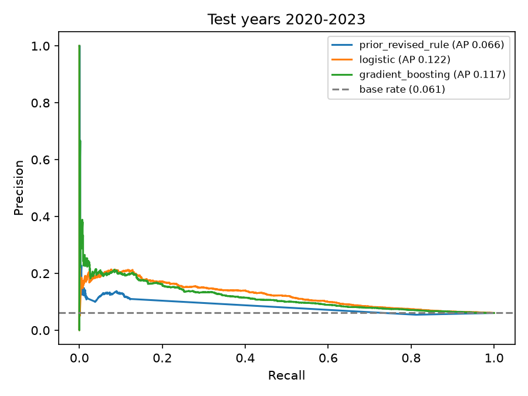

# Restatement Risk

[](https://github.com/tlevin1/restatement-risk/actions/workflows/tests.yml)

Can you tell, on the day a 10-K is filed, whether its numbers will later be
restated? This project builds that prediction from SEC EDGAR's XBRL data for
every US filer, with labels derived from the filings themselves, a strict
time-based split, and an honest comparison against simple baselines.

**Result:** on held-out years 2020–2023, a regularized logistic regression ranks
filings well enough that the top 100 each year restate at **~21%**, versus a
**6.1%** base rate. Gradient boosting does **not** beat it. The strongest single
signal is how late the company filed.



## Data and labels

Source: SEC's bulk [`companyfacts.zip`](https://www.sec.gov/search-filings/edgar-application-programming-interfaces)
(20,440 companies, 19 GB of XBRL facts). One row per company per fiscal year,
built from the **original** 10-K for that year.

A year is labelled **restated** if either:

- **Revised:** the *next* year's 10-K reports this year's net income or
  stockholders' equity differently from how it was originally filed, by more
  than 0.1% of originally reported total assets; or
- **Amended:** a 10-K/A with financial data was filed for this year.

Choices that matter, and why:

| Decision | Reason |
|---|---|
| Net income and equity only, not revenue or total assets | Revenue moves with discontinued-operations reclassifications; total assets moved for nearly everyone in 2015–16 when debt issuance costs were reclassified (ASU 2015-03). Neither is a restatement. |
| Scale revisions by total assets, not by the item | A $50k change on near-zero net income is a "100% revision" of nothing. |
| **Entity changes are excluded, not labelled** | After a reverse merger or de-SPAC, the prior-year comparatives belong to the merger target. Naively, that looks like a 300× "restatement". If total assets for the same date differ by more than 2× between filings, the label is unknown. The first model run was ranking these at the top; fixing it lowered the headline numbers and is the correct result. |
| **SPACs excluded** | 80% of SPAC FY2020 filings restated, after the SEC's April 2021 statement on warrant accounting. That wave was a regulatory reinterpretation no fundamental feature could predict, and SPACs are shells, not operating businesses. They are identified by a trust account on the balance sheet (`AssetsHeldInTrust*`), which also catches SPACs whose names don't say so. |
| No next 10-K and no amendment → dropped | A company that stops filing can't be called clean. This introduces survivorship bias, noted below. |
| Companies under $10M of assets excluded | Mostly shells and micro-entities with noisy filings. |

Base rates are stable at 5–7% by year, apart from a 2017 bump when ASC 606
(new revenue recognition) let companies restate prior years on adoption.

## Features (all known on the original filing date)

From the original 10-K and its own prior-year comparatives, plus anything
filed before it:

- **Accounting-quality signals** from the fraud-prediction literature
  (Dechow, Ge, Larson & Sloan 2011): accruals `(NI − CFO) / assets`, change in
  receivables and inventory, soft assets, asset and sales growth, ROA, losses.
- **Filing behaviour:** days from period end to filing, number of XBRL concepts
  reported, years of filing history.
- **History:** whether and by how much the prior year was revised (revealed in
  this very filing's comparatives), a prior 10-K/A, and a prior reverse merger or SPAC.
- **Integrity:** whether `Assets ≠ LiabilitiesAndStockholdersEquity` as tagged.

## Evaluation

| Split | Fiscal years | Rows | Positive rate |
|---|---|---|---|
| Train | 2011–2017 | 26,843 | 6.5% |
| Validation (model selection only) | 2018–2019 | 7,675 | 5.2% |
| Test (scored once) | 2020–2023 | 16,488 | 6.1% |

Split by **fiscal year**, never randomly: a random split would let the model
learn from a company's future to predict its past. Hyperparameters were chosen
on validation, then models were refit on train+validation and scored once on test.

**Test results (2020–2023):**

| Model | PR-AUC (95% CI) | ROC-AUC | Precision @ top 100 / year |
|---|---|---|---|
| Random ranking | 0.061 (0.056–0.067) | 0.50 | 6% |
| Rule: "revised or amended last year" | 0.066 (0.060–0.074) | 0.48 | 12% |
| **Logistic regression** | **0.122 (0.112–0.137)** | **0.66** | **21%** |
| Gradient boosting | 0.117 (0.105–0.133) | 0.64 | 20% |

PR-AUC is the headline metric because positives are rare: ROC-AUC looks
flattering on imbalanced data. "Precision @ top 100" is what an analyst
reviewing a fixed watchlist each year would actually experience.

- **Stable across years:** logistic PR-AUC 0.15 / 0.11 / 0.13 / 0.13 for
  2020–2023, each roughly double that year's base rate.
- **Monotone lift:** filings in the top-scored decile restate at 15.8%, the
  bottom decile at 3.3%, a 4.8× spread.
- **Boosting doesn't help:** its confidence interval overlaps logistic's, and
  before the entity-change fix it *appeared* to win by exploiting the
  contaminated reverse-merger feature. With ~50k rows and a weak signal, the
  simpler model is the right choice.
- **The obvious heuristic is weak.** "Restated last year" doubles precision at
  the very top but carries almost no ranking information overall.

**What drives the score** (permutation importance on test, and logistic
coefficients agree on direction):

1. **Days to file.** Late filers restate more. Companies that struggle to close
   their books on time are the same ones whose numbers don't hold.
2. **Size of last year's revision.**
3. **Asset growth.** Fast growth strains controls.
4. **Years of filing history** (negative: newer filers restate more).
5. Size, ROA, cash-to-assets (negative), accruals.

## Limitations

- **Label coverage.** Labels only see restatements that show up in XBRL: a
  changed comparative or a 10-K/A. A restatement disclosed some other way,
  or one that changes only line items other than net income and equity, is
  invisible, so some "clean" rows are not. Some top-ranked late filers that
  are labelled clean may be exactly such cases.
- **Survivorship.** Companies that stop filing (bankruptcy, delisting) have
  no label and are dropped, and those are plausibly the riskiest.
- **Revision ≠ fraud.** The label mixes error corrections with legitimate
  retrospective accounting changes. An auditor-change or SEC-comment-letter
  label from other sources would sharpen it.
- **Overlapping label windows.** Validation-year labels are revealed around the
  same time the first test-year filings are made. That affects model selection
  only marginally, but a fully purged split would leave a one-year gap.

## Reproduce

```bash
python3 -m venv .venv && .venv/bin/pip install -r requirements.txt

# SEC asks for a contact in the User-Agent
curl -A "Your Name you@example.com" -o data/raw/companyfacts.zip \
  https://www.sec.gov/Archives/edgar/daily-index/xbrl/companyfacts.zip   # 1.4 GB

.venv/bin/python -m restatement_risk.build_panel data/raw/companyfacts.zip data/panel.parquet  # ~40s on 8 cores
.venv/bin/python -m restatement_risk.train data/panel.parquet reports/                         # ~25s
.venv/bin/python -m pytest -q                                                                  # 11 tests
```

`reports/results.json` holds every number above, including per-year base rates
and the full permutation importance table. EDGAR updates nightly, so a rerun on
newer data will shift the numbers slightly.

## Layout

```
restatement_risk/
  facts.py         indexed, filing-scoped access to one company's XBRL facts
  panel.py         features and labels per company-year (leakage rules live here)
  build_panel.py   parallel streaming over the bulk zip → parquet
  train.py         time split, tuning, evaluation, plots
tests/test_panel.py  hand-checkable synthetic filings: restatements, amendments,
                     reverse mergers, SPACs, retail fiscal years
```

Related: [edgar-mcp](https://github.com/tlevin1/edgar-mcp), the MCP server that
reads the same XBRL data for interactive analysis in Claude Code.
